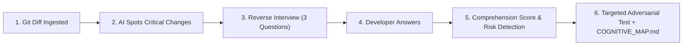

# 🛡️ UnderstandGuard

> **"AI can write the code. UnderstandGuard makes sure you understand the change."**

[](https://devpost.com)
[](https://nextjs.org)
[](https://www.typescriptlang.org)
[](#the-solution-flipped-interaction)

UnderstandGuard is a pre-merge accountability and cognitive debt auditor for AI coding agents (Claude Code, Cursor, GitHub Copilot). Instead of passively summarizing PRs, it **reverses the interaction**: the AI interviews the developer on critical lines, exposes shallow comprehension, and synthesizes targeted adversarial tests.

---

## ⚡ Quick Links & Planning Artifacts

As required by the **Devpost: Build with AI — Basics** hackathon guidelines:

* 🎯 **[`scope.md`](./scope.md)** — Project boundaries, MVP criteria, and explicit out-of-scope constraints.
* 📋 **[`prd.md`](./prd.md)** — User personas (AI developer vs. tech lead), user journeys, and success metrics.
* 📐 **[`spec.md`](./spec.md)** — Technical architecture, Mermaid sequence flows, AST parsing, and API schemas.
* 📦 **[`fixtures/`](./fixtures/)** — Demo diff (`auth.patch`), question fixtures, and adversarial test suites.

---

## 🚨 The Problem: "Cognitive Debt"

With tools like Cursor and Claude Code, developers accept AI-generated code blocks at blistering speed. But velocity comes with a hidden cost: **Cognitive Debt**.

> **Cognitive Debt** is code accepted into a codebase that the human author cannot explain, debug, or maintain under pressure.

* **Passive AI Summaries Fail:** Summaries like *"This PR refactors auth"* are skimmed and ignored. They create the illusion of understanding without enforcing comprehension.
* **Linters Miss Intent:** Static analyzers check types and syntax, but cannot detect logical race conditions, unhandled rate limits (HTTP 429), or state desynchronization.
* **Reviewers are Overwhelmed:** Senior engineers cannot distinguish between code an author deeply understands and code they blindly copied.

---

## 💡 The Solution: Flipped Interaction + Adversarial Testing

UnderstandGuard transforms PR review into an active verification loop:



1. **Diff Pre-flight Check:** Automatically parses unified diffs and isolates high-risk hunks (concurrency, auth tokens, error boundaries).
2. **Reverse Interview:** The AI acts as a Principal Architect, asking 3 line-specific probing questions.
3. **Comprehension Scoring:** Evaluates technical accuracy vs. vague hand-waving (e.g. *"It handles errors gracefully"* triggers `⚠️ Vague Explanation`).
4. **Targeted Adversarial Testing:** Generates a runnable Vitest test that deliberately breaks the exact function the author could not explain.
5. **Architectural Map Export:** Produces `COGNITIVE_MAP.md` with a Mermaid sequence diagram and review verdict.

---

## 🎬 2-Minute Demo Flow (`/demo`)

UnderstandGuard includes a dedicated `/demo` route pre-loaded with a realistic 42-line `auth.ts` diff:

| Timestamp | Visual Action | What the Judges See |
| :--- | :--- | :--- |
| **0:00 – 0:15** | Hero screen & terminal | *"AI writes code. Humans must understand it."* Introduction to cognitive debt. |
| **0:15 – 0:40** | Diff Viewer (`/demo`) | Reviewing `src/auth.ts` (token refresh flow with missing concurrency lock). |
| **0:40 – 1:10** | Reverse Interview | System asks 3 line-specific questions targeting lines 41, 48, and 70. |
| **1:10 – 1:25** | Vague Answer Input | Developer enters vague answer for Q2 (*"Handles errors gracefully"*); system flags **"⚠️ Vague Explanation"**. |
| **1:25 – 1:40** | Adversarial Test | System generates test targeting `refreshToken()`; shows assertion failure: `expect(call2.status).toBe('fulfilled') // ❌ Received: 500`. |
| **1:40 – 1:55** | Export Dashboard | Reviews `COGNITIVE_MAP.md` and Mermaid sequence diagram. |
| **1:55 – 2:00** | Conclusion | *"UnderstandGuard turns AI-generated code from something you blind-accept into something you can explain."* |

---

## 🛠️ Tech Stack & Architecture

* **Frontend:** Next.js 14 (App Router), React 18, Tailwind CSS, Lucide Icons.
* **Diff Parsing:** `parse-diff` for unified diff hunk and line analysis.
* **AI Orchestration:** Google Gemini 1.5/2.5 Flash via `@google/generative-ai`.
* **Reliability Engine:** Built-in deterministic mock router (`?mock=true`) guaranteeing zero-delay, zero-failure presentations.

---

## 🚀 Running Locally

### 1. Clone & Install
```bash
git clone https://github.com/<your-username>/understandguard.git
cd understandguard
npm install
```

### 2. Configure Environment (Optional)
```bash
cp .env.example .env.local
# Add your GEMINI_API_KEY (Optional - Mock mode works completely offline!)
```

### 3. Run Development Server
```bash
npm run dev
```

Visit [http://localhost:3000](http://localhost:3000) for custom diff analysis, or [http://localhost:3000/demo](http://localhost:3000/demo) for the one-click presentation demo.

### 4. Build Production Bundle
```bash
npm run build
npm start
```

---

## 🏆 Hackathon Alignment

| Criteria | How UnderstandGuard Delivers |
| :--- | :--- |
| **Impact** | Solves the primary bottleneck of modern software engineering: unmaintainable AI-generated PRs. |
| **AI Implementation** | Uses AI to enforce developer accountability through targeted reverse-interviewing and test synthesis, rather than shallow chatbots. |
| **Innovation** | Operationalizes the *Flipped Interaction Method* into a functional pre-merge tool. |
| **Execution** | Clean, bug-free single-task PoC with instant reset capabilities and deterministic mock safety. |
| **Presentation** | Fully documented with `scope.md`, `prd.md`, `spec.md`, and a rehearsed 2-minute video script.
