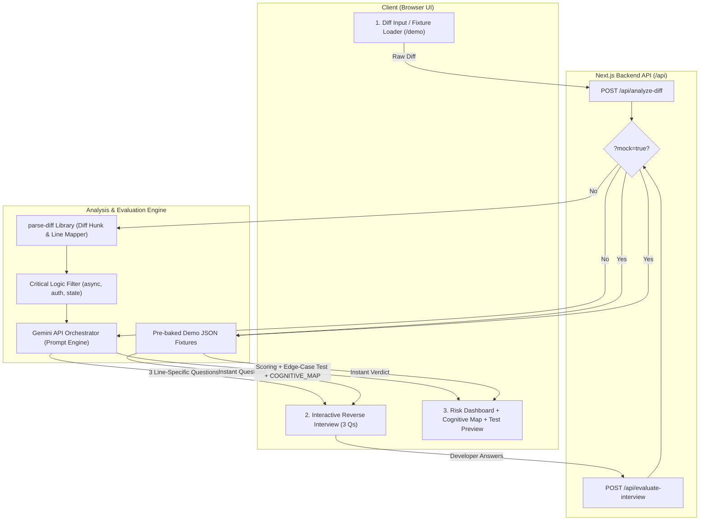

# Technical Specification (SPEC): UnderstandGuard

**System:** UnderstandGuard Engine & Web Application  
**Version:** 1.0.0-MVP  
**Hackathon Target:** Devpost — Build with AI: Basics (2026)  
**Status:** Approved Technical Architecture  

---

## 1. System Architecture & Component Flow

UnderstandGuard is structured as a full-stack TypeScript application with a Next.js App Router architecture, leveraging `parse-diff` for local structural parsing, Google Gemini API for reverse-interview question generation and adversarial testing, and a deterministic mock fallback layer for rock-solid demo recordings.



---

## 2. Directory Structure

```text
understandguard/
├── app/
│   ├── layout.tsx              # Root layout with dark terminal theme
│   ├── page.tsx                # Main application interface
│   ├── demo/
│   │   └── page.tsx            # Pre-loaded 1-click recording route with Reset button
│   └── api/
│       ├── analyze-diff/
│       │   └── route.ts        # POST: Parses diff and generates 3 interview questions
│       └── evaluate-interview/
│           └── route.ts        # POST: Scores answers and synthesizes test + cognitive map
├── lib/
│   ├── diff-parser.ts          # parse-diff wrapper and hunk/line mapper
│   ├── gemini.ts               # Google Gemini API client with structured JSON output
│   ├── heuristics.ts           # Critical logic detector (async, mutex, state, 429)
│   └── fixtures/
│       ├── demo-diff.ts        # Realistic 45-line auth.ts diff fixture
│       └── demo-responses.ts   # Pre-baked questions, vague answers, and test suite
├── components/
│   ├── DiffViewer.tsx          # Clean syntax-highlighted diff viewer
│   ├── InterviewModal.tsx      # Step-by-step interview card with line references
│   ├── RiskBadge.tsx           # Visual risk indicator & comprehension score
│   ├── TestPreview.tsx         # Crisp adversarial test preview & assertion diff
│   └── CognitiveMapExport.tsx  # Mermaid diagram & Markdown export drawer
├── package.json
└── tsconfig.json
```

---

## 3. API Contracts & Data Models

### 3.1. `POST /api/analyze-diff`
Ingests a raw Git diff and returns line-mapped critical functions along with 3 targeted questions.

#### Request Schema
```typescript
export interface AnalyzeDiffRequest {
  diff: string;         // Raw unified diff text
  mock?: boolean;       // Set true to bypass LLM and return demo fixture
}
```

#### Response Schema
```typescript
export interface AnalyzeDiffResponse {
  file: string;                    // e.g. "auth.ts"
  totalAdditions: number;
  totalDeletions: number;
  criticalFunctions: {
    name: string;
    startLine: number;
    endLine: number;
    riskCategory: "CONCURRENCY" | "AUTH_STATE" | "ERROR_HANDLING" | "NETWORK";
  }[];
  questions: {
    id: string;
    targetLine: number;
    targetFunction: string;
    prompt: string;
    contextSnippet: string;
    expectedInsight: string;
  }[];
}
```

---

### 3.2. `POST /api/evaluate-interview`
Evaluates developer responses against actual diff mechanics, producing comprehension scores, risk flags, an adversarial test, and `COGNITIVE_MAP.md`.

#### Request Schema
```typescript
export interface EvaluateInterviewRequest {
  diff: string;
  questions: {
    id: string;
    targetLine: number;
    targetFunction: string;
    prompt: string;
  }[];
  answers: {
    questionId: string;
    userAnswer: string;
  }[];
  mock?: boolean;
}
```

#### Response Schema
```typescript
export interface EvaluateInterviewResponse {
  comprehensionScore: number;          // 0 to 100
  riskLevel: "LOW" | "MEDIUM" | "HIGH";
  verdictBadge: "Safe to Review" | "High Cognitive Debt – Review Required";
  evaluations: {
    questionId: string;
    score: number;                     // 0 to 10
    isVague: boolean;
    critique: string;
    identifiedBlindSpot?: string;
  }[];
  adversarialTest: {
    targetFunction: string;
    targetLine: number;
    testFramework: "vitest";
    testCode: string;
    assertionFailure: string;          // e.g. "expect(res.status).toBe(200) // got 500"
    vulnerabilityExplanation: string;
  };
  cognitiveMapMarkdown: string;        // Formatted COGNITIVE_MAP.md with Mermaid
}
```

---

## 4. Critical Logic Detection Algorithm

Before calling the LLM, the `lib/heuristics.ts` engine inspects diff hunks to isolate lines requiring scrutiny:

```typescript
export function identifyCriticalLines(hunks: DiffHunk[]): CriticalSegment[] {
  // Regex heuristics matching high-risk agent failure points
  const patterns = {
    CONCURRENCY: /(async\s+|await\s+|Promise\.all|mutex|lock|race)/i,
    AUTH_STATE: /(token|refresh|session|jwt|header|bearer|authorization)/i,
    ERROR_HANDLING: /(catch|try|throw|retry|backoff|status\s*===?\s*429)/i,
    MUTATION: /(useState|state\.|push\(|delete\s+|splice\()/i,
  };

  // Maps line numbers from diff to absolute code coordinates
  // Returns top 3 most vulnerable locations to ground LLM questions
}
```

---

## 5. Reverse-Interview & Scoring Prompts

### 5.1. System Prompt: Question Generation
```text
You are UnderstandGuard, an elite code reviewer. Your job is to test if a developer genuinely understands an AI-generated Git diff or if they are blindly trusting it (accumulating Cognitive Debt).

Given the following diff:
1. Identify the single most critical or fragile logic block (e.g. race conditions, unhandled rate limits, missing error boundaries).
2. Generate exactly 3 targeted, technical questions.
3. Every question MUST explicitly reference an exact line number or function name (e.g., "In line 48 of refreshToken()").
4. Never ask generic questions. Probe failure modes, async flow, and edge cases.
Output strictly formatted JSON matching the AnalyzeDiffResponse schema.
```

### 5.2. System Prompt: Scoring & Adversarial Test Synthesis
```text
You are evaluating the developer's answers to verify comprehension.
Criteria:
- Vague non-answers (e.g., "It handles errors gracefully", "It's standard async code") get score <= 4 and isVague = true.
- Precise answers demonstrating awareness of race conditions, nulls, and error states get score >= 8 and isVague = false.

If any answer is vague:
1. Flag that specific function as High Cognitive Debt.
2. Generate an adversarial unit test in Vitest that exploits the exact edge case the developer failed to explain.
3. Provide a single-line assertion failure string showing why the code breaks.
4. Output a concise COGNITIVE_MAP.md including a Mermaid sequence diagram and review badge.
Output strictly formatted JSON matching the EvaluateInterviewResponse schema.
```

---

## 6. Deterministic Demo Fixture (`auth.ts`)

To ensure flawless 2-minute video recording without network or API delays:

* **File:** `src/auth.ts`
* **Size:** 42 lines
* **Scenario:** An AI-generated `refreshToken()` implementation that:
  1. Lacks concurrency deduplication (multiple simultaneous 401s fire 10 duplicate refresh requests).
  2. Lacks exponential backoff on HTTP 429 Too Many Requests.
* **Pre-baked Answers for Demo:**
  * **Q1 Answer (Good):** *"Lines 38-42 read the stored refresh token from secure storage and send a POST to /auth/refresh."* (Score: 9/10)
  * **Q2 Answer (Vague):** *"It handles error states properly and retries if needed."* (Score: 3/10 — Triggers **"⚠️ Vague Explanation"** badge)
* **Generated Test Output:**
  ```typescript
  it("fails when multiple concurrent requests trigger simultaneous token refreshes", async () => {
    const [res1, res2] = await Promise.all([refreshToken(), refreshToken()]);
    // Expect: Single refreshed token shared across callers
    // Actual assertion failure:
    expect(res2.status).toBe(200); // ❌ Received: 500 (Token already invalidated by first call)
  });
  ```

---

## 7. Reliability & Hackathon Submission Safeguards

1. **One-Click Demo Route (`/demo`):** Pre-wires the exact demo diff and answers. A **"Reset"** button restores initial state instantly.
2. **Deterministic Mock Mode (`?mock=true`):** Bypasses network and LLM calls, returning deterministic responses in under 50ms.
3. **Deployment Target:** Hosted directly on Vercel for immediate public accessibility with live URL submitted on Devpost.
